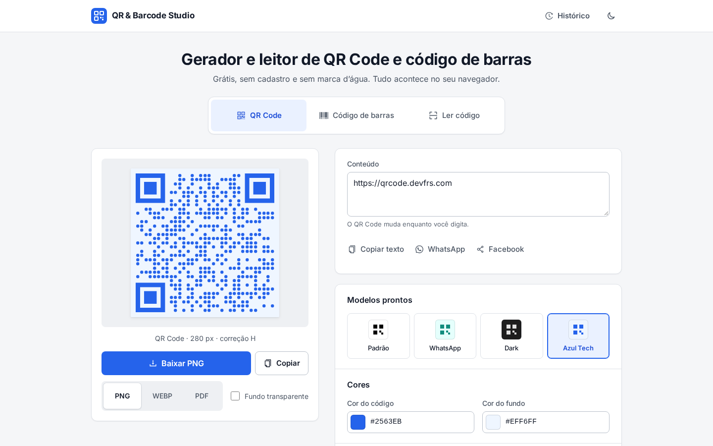

<div align="center">

# QR & Barcode Studio

A free, fully client-side web app to **generate**, **customize**, and **scan** QR Codes and barcodes (25+ formats), with a reader that decodes Brazilian **NF-e / NFC-e** access keys. Live preview, logo embedding, PNG / WEBP / PDF / SVG export, light and dark themes, and a local history. No backend, no sign-up, no watermark: nothing leaves your device.

[](https://github.com/Franklyn-R-Silva/barcode-qr-generator/actions/workflows/ci.yml)
[](./LICENSE)
[](https://www.bestpractices.dev/projects/17194)
[](https://react.dev/)
[](https://qrcode.devfrs.com)
[](./CONTRIBUTING.md)
[](https://github.com/Franklyn-R-Silva/barcode-qr-generator/issues?q=is%3Aissue%20is%3Aopen%20label%3A%22good%20first%20issue%22)

**[🌐 Live App — qrcode.devfrs.com](https://qrcode.devfrs.com)**



</div>

> **Note:** The interface is in Brazilian Portuguese (pt-BR); the target audience is Brazilian users. The codebase and documentation are in English.

## Table of Contents

- [Features](#features)
- [Getting Started](#getting-started)
- [Available Scripts](#available-scripts)
- [Deployment](#deployment)
- [Architecture](#architecture)
- [Design](#design)
- [Tech Stack](#tech-stack)
- [Contributing](#contributing)
- [Quality and security](#quality-and-security)
- [Security](#security)
- [License](#license)

## Features

### QR Codes

- Content types: **link, text, Pix, WhatsApp, Wi-Fi, e-mail, phone, SMS and contact (vCard)**, each with its own form
- **Pix**: static QR Code in the Banco Central BR Code format (key, name, city, optional amount and description), plus the "copia e cola" text
- Optional frame with a label such as "Escaneie-me": a band underneath, a U-shaped arc, or text running round a circle or a square
- **Artistic QR**: a photo behind the code, with lightening and module-size controls
- **Logo** with size, rounded corners (up to a circle), border, opacity and cleared modules, plus a meter showing how much of the code it covers against what the chosen error correction can recover
- **Live read test**: after every change the app reads its own code back and says whether it scans
- Module styles (squares, rounded, dots), eye styles (square, rounded, circles), gradient, eye colour and adjustable margin
- **Import from an image**: read an existing QR Code from a photo or screenshot and recreate it

- Full color customization (foreground and background)
- Module styles (squares or dots) and eye styles (square or rounded)
- Logo upload with adjustable size, opacity, and background removal
- Four error-correction levels (L, M, Q, H)
- Ready-made templates (Padrão, WhatsApp, Dark, Azul Tech)
- A warning when the colours are too light or inverted to scan reliably

### Barcodes (25+ formats)

| Family    | Formats                                          |
| --------- | ------------------------------------------------ |
| Code      | Code 39 · Code 93 · Code 128 (Auto, A, B, C)     |
| GS1 & ITF | GS1-128 · ITF · ITF-14                           |
| EAN/ISBN  | EAN-13 · EAN-8 · EAN-5 · EAN-2 · ISBN            |
| UPC       | UPC-A · UPC-E _(auto-expanded to UPC-A)_         |
| Other     | MSI (10, 11, 1010, 1110) · Pharmacode · Codabar  |

Every format has dedicated input validation with example values and inline error hints.

### Scanner & NF-e reader

- Read QR Codes and 1D barcodes (Code 128, Code 39, EAN, UPC, ITF, Codabar) using
  the **device camera** or by **uploading an image**
- Automatic recognition of Brazilian electronic invoices (**NF-e / NFC-e**, and
  CT-e / MDF-e) from either the DANFE barcode or the NFC-e QR Code URL
- Decodes the 44-digit access key into its fields — issuing state, emission month,
  issuer CNPJ, document model, series, and number — and validates its check digit
  (modulo 11)
- One tap to copy the content, open a scanned link, jump to the official SEFAZ
  lookup portal, or turn the scanned value back into a QR Code / barcode

> Camera scanning requires a secure context (HTTPS or `localhost`) and the user's
> camera permission. Image upload works everywhere.

### General

- Export to **PNG**, **WEBP**, **PDF**, and **SVG** (QR Codes and barcodes), with an optional transparent background shown on a checkerboard
- Copy the generated image straight to the clipboard
- Light / dark theme that follows the system on the first visit and is remembered
- Local generation history (stored in `localStorage`)
- Social sharing (WhatsApp, Facebook)
- Responsive, mobile-first layout · installable PWA

## Getting Started

**Prerequisites:** [Node.js 20](https://nodejs.org/) (pinned in `.nvmrc`)

```bash
git clone https://github.com/Franklyn-R-Silva/barcode-qr-generator.git
cd barcode-qr-generator
npm install
npm start
```

The app will be available at [http://localhost:3000](http://localhost:3000).

## Available Scripts

| Command         | Description                          |
| --------------- | ------------------------------------ |
| `npm start`     | Start the development server         |
| `npm run build` | Create an optimized production build |
| `npm test`      | Run the test suite (Jest + RTL, watch mode) |
| `npm test -- --watchAll=false` | Run the tests once (as CI does) |

## Deployment

The app is hosted on **Cloudflare Workers** (static assets) under the custom domain
**[qrcode.devfrs.com](https://qrcode.devfrs.com)**. It is a fully static build —
there is no server-side component.

Cloudflare rebuilds on every push to `main`. The static `build/` output is
uploaded as Cloudflare Workers static assets via `wrangler.jsonc` (the deploy step
runs `npx wrangler deploy`).

| Setting                | Value           |
| ---------------------- | --------------- |
| Build command          | `npm run build` |
| Deploy command         | `npx wrangler deploy` |
| Build output directory | `build` (also set in `wrangler.jsonc` → `assets.directory`) |
| Node version           | `20` (pinned via `.nvmrc`; Wrangler 4 requires Node ≥ 20) |

`wrangler.jsonc` configures a static-assets-only Worker (no server code) with SPA
fallback. The custom domain and DNS are managed in the Cloudflare dashboard, so no
`homepage` field or `CNAME` file is required — assets load from the domain root.

## Architecture

Create React App (React 18), running entirely in the browser. A single `config`
state object in `App.jsx` drives both generators and the scanner, and flows down
to the preview, control, and scanner components.

```
src/
├── components/
│   ├── layout/      # Header, Footer
│   ├── common/      # Toast, Segmented control
│   ├── generator/   # QRCodePreview, BarcodePreview, Controls, ModeSelector,
│   │                # ExportOptions, ColorPickerAdvanced, History*
│   └── scanner/     # ScannerPanel (camera + image reader, NF-e details)
├── constants/       # Generator/mode types & barcode format definitions
└── utils/           # Barcode validators, NF-e access-key parser, colour contrast
```

QR codes are drawn as SVG by `utils/qrSvg.js` (on top of `qrcode-generator`), barcodes as SVG by `react-barcode`
(via `react-barcode`/JsBarcode), and the scanner uses `html5-qrcode`; export logic
adapts to each path. See [ARCHITECTURE.md](./ARCHITECTURE.md) for the full picture.

## Design

The interface follows the familiar layout of the best QR generators: the code on
the left, always in view, with one blue button to download it; content and
appearance settings on the right. On phones the order is content, code, settings.

The redesign was made with [impeccable](https://github.com/pbakaus/impeccable).
[`PRODUCT.md`](./PRODUCT.md) records who the app is for and its constraints, and
[`DESIGN.md`](./DESIGN.md) documents the tokens and components. With Claude Code,
the impeccable skill and its design hook are already set up in `.claude/`.

## Tech Stack

- **React 18** (Create React App), plain CSS with design tokens
- **Inter** (Google Fonts) — UI typeface
- **qrcode-generator** — QR matrix (drawn as SVG by `utils/qrSvg.js`)
- **react-barcode** / **JsBarcode** — barcode rendering
- **html5-qrcode** — camera & image scanning
- **react-colorful** — color picker
- **jsPDF** — PDF export
- **react-icons** — icons

## Contributing

**Anyone can contribute**, and first-time contributors are very welcome. You can
report a bug, suggest an idea, improve the docs, or pick up an issue — no need
to know the whole codebase first.

1. Look at the [good first issues](https://github.com/Franklyn-R-Silva/barcode-qr-generator/issues?q=is%3Aissue%20is%3Aopen%20label%3A%22good%20first%20issue%22)
   or [open an issue](https://github.com/Franklyn-R-Silva/barcode-qr-generator/issues/new/choose) describing what you want to change.
2. Fork, then `npm ci` and `npm start`.
3. Make the change, add a test when it changes behaviour, and run `npm test`.
4. Open a pull request with `Closes #<issue>`. CI runs the tests and the build.

[CONTRIBUTING.md](./CONTRIBUTING.md) has the details, and the
[Code of Conduct](./CODE_OF_CONDUCT.md) applies to everyone. Issues and pull
requests can be written in Portuguese or English.

## Quality and security

- **[OpenSSF Best Practices](https://www.bestpractices.dev/projects/17194)**:
  the project follows the Open Source Security Foundation checklist for open
  source projects (licence, contribution process, tests, vulnerability
  reporting, secure delivery). The badge at the top shows the current level.
- **CI** runs the tests and a production build on every pull request.
- **CodeQL** scans the JavaScript and the workflows; **Dependabot** keeps
  dependencies up to date in grouped monthly pull requests.
- **Secret scanning** with push protection is on.

## Security

Found a vulnerability? Please report it privately; see [SECURITY.md](./SECURITY.md).

## License

Released under the [MIT License](./LICENSE).

## Author

**Franklyn Silva** — [GitHub](https://github.com/Franklyn-R-Silva) · [LinkedIn](https://www.linkedin.com/in/franklyn-roberto-dev/)
